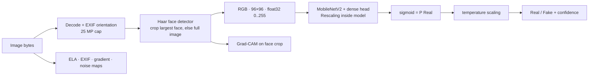

# 🔍 PixelTruth — AI-Generated Face Detector

<p align="center">
  
  
  
  
  
</p>

> **PixelTruth** classifies a face image as **Real** or **AI-generated (Fake)** using a fine-tuned MobileNetV2, and adds forensic views (Grad-CAM, Error Level Analysis, EXIF, luminance-gradient and noise-residual maps) to help a human judge the result. It ships with a trained model, a Streamlit dashboard, a REST API and a CLI.

---

## 📌 Table of Contents

- [Performance](#-performance)
- [Quick start](#-quick-start)
- [Usage: dashboard, API, CLI](#-usage)
- [How it works](#-how-it-works)
- [Model input contract](#-model-input-contract)
- [Re-training and evaluation](#-re-training-and-evaluation)
- [Testing](#-testing)
- [Deployment](#-deployment)
- [Configuration](#%EF%B8%8F-configuration)
- [Project structure](#-project-structure)
- [Limitations](#%EF%B8%8F-limitations)
- [Contributing](#-contributing) · [License](#-license)

---

## 📊 Performance

These are the measured results for the bundled model `deepfake_detection_model.h5` (contract v2.0.0) on the **held-out test split** (images never used for training or model selection). They were produced by `evaluate.py`, which uses the same face-crop pipeline as the app, and are stored in [`metrics_cache.json`](metrics_cache.json).

| Metric (test set, 20,000 images, balanced) | Value |
|---|---|
| Accuracy | **93.4%** |
| Precision / Recall / F1 (support-weighted) | 93.4% / 93.4% / 93.4% |
| ROC AUC | 0.9833 |
| Real-image accuracy | 92.1% (9,208 / 10,000) |
| Fake-image accuracy | 94.7% (9,473 / 10,000) |
| Validation accuracy (model selection) | 93.0% on 10,000 images |
| Training set | 50,001 images, 11 epochs (CPU) |
| Input | 96 × 96 face crop |

Training details (dataset size, epochs, fitted calibration temperature, SHA-256) are in [`deepfake_detection_model.json`](deepfake_detection_model.json).

Dataset: [140k Real and Fake Faces](https://www.kaggle.com/datasets/xhlulu/140k-real-and-fake-faces): real faces from FFHQ, fake faces generated by StyleGAN. It is downloaded from its public Hugging Face mirror `TheKernel01/140k-Real-and-Fake-Faces`.

> ⚠️ These numbers describe **StyleGAN-style faces vs FFHQ photos**. Expect lower accuracy on other generators (diffusion models, face swaps), heavily compressed social-media images and non-face images. See [Limitations](#%EF%B8%8F-limitations).

---

## 🚀 Quick start

**Prerequisite:** Python **3.11**. TensorFlow 2.16 does not support 3.12+ here. On Windows you also need the [Microsoft Visual C++ Redistributable](https://aka.ms/vs/17/release/vc_redist.x64.exe).

```bash
git clone https://github.com/Piyush-Sharma788/PixelTruth.git
cd PixelTruth

python3.11 -m venv venv
source venv/bin/activate            # Windows: venv\Scripts\activate
pip install -r requirements.txt

streamlit run app.py                # → http://localhost:8501
```

That's it. The trained model (`deepfake_detection_model.h5`, ~12 MB) is part of the repository, so there is nothing to download or configure.

<details>
<summary>Using a different model file</summary>

The app looks for the model in this order:

1. `PIXELTRUTH_MODEL_PATH` (default `deepfake_detection_model.h5` in the project root);
2. if that file is missing and `PIXELTRUTH_MODEL_URL` is set (HTTPS only), it downloads it, e.g. from a GitHub Release asset;
3. if `PIXELTRUTH_MODEL_SHA256` is set, the file is verified on every load. A mismatching download is deleted.

```bash
python scripts/download_model.py --url https://…/model.h5 --sha256 <digest> --dest my_model.h5
PIXELTRUTH_MODEL_PATH=my_model.h5 streamlit run app.py
```

The model must follow the [input contract](#-model-input-contract).
</details>

---

## 🧭 Usage

### Streamlit dashboard — `streamlit run app.py`

- **Batch Analysis:** upload one or more JPG/PNG/WebP images (≤10 MB each). For each image you get:
  - the Real/Fake verdict and confidence;
  - the detected face box and Grad-CAM heatmap;
  - ELA, luminance-gradient and noise-residual maps;
  - an EXIF summary.
- **Forensic Comparison:** analyse two images side by side, including a metadata diff.
- **Sidebar:**
  - *Confidence threshold:* below it, a result is shown as "Low Confidence — Uncertain".
  - *Calibration temperature:* rescales the confidence without ever changing the verdict.
- **Prediction history:** saved to SQLite, viewable newest first, exportable as CSV (formula-injection safe) and clearable.
- **Model analytics:** test-set accuracy, precision, recall, F1, ROC, confusion matrix and per-class stats, all read from `metrics_cache.json`.

### REST API — `uvicorn api.main:app --port 8000`

Interactive docs are at **http://localhost:8000/docs**.

| Method | Path | Description |
|---|---|---|
| `POST` | `/api/detect` | Synchronous detection. Multipart field `file`; optional `?temperature=` (0 < T ≤ 100) |
| `POST` | `/api/detect/async` | Queue a detection and return `202 {"task_id": …}` |
| `GET` | `/api/task/{task_id}` | `pending` → `running` → `completed` / `failed` (kept 5 min) |
| `GET` | `/api/health` | Liveness check, plus `model_loaded`, `model_version` and `active_tasks` |

```bash
curl -F "file=@face.jpg" http://localhost:8000/api/detect
```

```json
{
  "verdict": "Fake",
  "confidence": 0.97,
  "is_uncertain": false,
  "confidence_threshold": 0.7,
  "raw_scores": [0.03],
  "face_detected": true,
  "face_box": [41, 57, 170, 170]
}
```

`raw_scores` is the model's uncalibrated sigmoid output, P(Real). `face_box` is `[x, y, w, h]` in the uploaded image.

Errors:

| Status | Meaning |
|---|---|
| `400` | Not an image, or corrupted |
| `401` | Bad or missing `X-API-Key`, when `PIXELTRUTH_API_KEY` is set |
| `413` | File larger than 10 MB |
| `422` | Invalid parameters |
| `429` | Rate limit exceeded (includes `Retry-After`) |
| `503` | Too many queued async tasks |

### CLI — `predict.py`

```bash
python predict.py face1.jpg face2.png            # human-readable output
python predict.py face.jpg --json                # machine-readable output
python predict.py face.jpg --model other.h5 --temperature 1.0 --threshold 0.7
```

The exit code is `1` if any image failed.

---

## 🧠 How it works



The same `preprocessing.prepare_model_input` function is used by **training, evaluation, the dashboard, the API and the CLI**, so the model always sees images prepared exactly the way it was trained.

The forensic maps (ELA, EXIF, gradient, noise) are **heuristic aids for a human reviewer**. They do not feed into the verdict, and they were not validated as detectors.

---

## 📐 Model input contract

**Version v2.0.0** (`config.MODEL_VERSION`), implemented in `preprocessing.prepare_model_input`:

1. Detect the largest frontal face with OpenCV's Haar cascade and crop it. If no face is found, use the full image.
2. Convert to RGB, resize to **96×96**, and cast to float32 in **[0, 255]**.
3. The model's first layers are `RandomFlip` (training only) and `Rescaling(1/127.5, offset=-1)`, which maps the input to MobileNetV2's [-1, 1] range.
4. Output: a single sigmoid value, **P(Real)**. Class indices are Fake = 0, Real = 1.

Models trained with the older `experiments/train*.py` scripts (v1, which had no face crop) are not compatible with this contract.

---

## 🔁 Re-training and evaluation

Training was verified on a CPU (Apple M4: about 4 min of preprocessing plus about 35 min of training for ~50k images).

```bash
pip install -r requirements-dev.txt
python scripts/prepare_dataset.py          # ≈1.8 GB download; 50k train / 10k val / 20k test faces
python experiments/train_v4.py             # writes deepfake_detection_model.h5, .json, Figure_1/2.png
python evaluate.py --test-dir data/faces/test   # writes metrics_cache.json
```

- `prepare_dataset.py --train-shards 6` uses the full 100k training set.
- `train_v4.py` fits the calibration temperature on the validation split. Copy it into `config.DEFAULT_TEMPERATURE`.
- `evaluate.py` works with sigmoid and 2-class softmax models. Commit the regenerated `metrics_cache.json` with the model.

`experiments/train.py`, `train_v2.py` and `train_v3.py` are kept only for history. They expect the old Kaggle folder layout and the v1 contract.

---

## 🧪 Testing

```bash
pip install -r requirements-dev.txt
python -m pytest tests -q -rs
```

- Most tests use mocks or synthetic images and need no model.
- `tests/test_real_model.py` runs the **real bundled model**: contract checks, synthetic inference, Grad-CAM, and the API with a real model.
  - Its accuracy and API cases also need labelled faces in `data/faces/test`. Create them with `python scripts/prepare_dataset.py --train-shards 0 --val-shards 0`.
  - These cases are skipped automatically if the faces are absent.
- `tests/test_app_smoke.py` starts the Streamlit app headlessly with the real model.

CI (GitHub Actions) runs `pip check`, a merge-conflict scan, `compileall`, a SHA-256 check of the bundled model, and the full test suite.

---

## 🚢 Deployment

**Docker** (one image, two services):

```bash
docker compose up --build     # UI on :8501, API on :8000
```

To run them separately:

```bash
docker build -t pixeltruth .
docker run -p 8501:8501 pixeltruth
docker run -p 8000:8000 pixeltruth uvicorn api.main:app --host 0.0.0.0 --port 8000
```

**Streamlit Community Cloud:** point it at `app.py`. `runtime.txt` (Python 3.11), `packages.txt` and `.streamlit/config.toml` are already provided.

**Production checklist:**
- [ ] Set `PIXELTRUTH_PERSIST_HISTORY=0` for public UIs. Otherwise every visitor shares one SQLite history.
- [ ] Set `PIXELTRUTH_API_KEY`.
- [ ] Set `PIXELTRUTH_CORS_ORIGINS` to your frontend's origin.
- [ ] Run the API with a **single worker**. The async task store is in-process memory.

---

## ⚙️ Configuration

All settings are optional environment variables (or a `.env` file). See [`.env.example`](.env.example).

| Variable | Default | Purpose |
|---|---|---|
| `PIXELTRUTH_MODEL_PATH` | `deepfake_detection_model.h5` | Model file |
| `PIXELTRUTH_MODEL_URL` / `_SHA256` | — | Optional HTTPS download and integrity check |
| `PIXELTRUTH_API_KEY` | — (open) | Required `X-API-Key` for the API |
| `PIXELTRUTH_RATE_LIMIT` / `_POLL_RATE_LIMIT` | `10/minute` / `120/minute` | Per-IP limits for detect / task polling |
| `PIXELTRUTH_MAX_ACTIVE_TASKS` | `32` | Cap on queued async tasks |
| `PIXELTRUTH_CORS_ORIGINS` | `http://localhost:8501,http://localhost:8000` | API CORS allowlist |
| `PIXELTRUTH_DB_PATH` | `pixeltruth_history.db` | SQLite history file |
| `PIXELTRUTH_PERSIST_HISTORY` | `1` | `0` = per-session history only |
| `PIXELTRUTH_MAX_PIXELS` | `25000000` | Decompression-bomb guard |

---

## 📁 Project structure

```
PixelTruth/
├── app.py                     # Streamlit dashboard
├── api/main.py, task_store.py # FastAPI app + in-memory async task store
├── predict.py                 # Unified inference pipeline + CLI
├── preprocessing.py           # Decoding, face crop, canonical model input
├── utils/model_loader.py      # Cached model loading
├── model_utils.py             # Model path / download / checksum
├── calibration.py             # Temperature scaling
├── gradcam.py                 # Grad-CAM heatmaps
├── ela_analysis.py, exif_analysis.py, forensic_filters.py
├── history.py                 # SQLite prediction history
├── evaluate.py, metrics.py    # Offline evaluation → metrics_cache.json → dashboard charts
├── config.py, exceptions.py   # Shared constants and error types
├── deepfake_detection_model.h5 / .json   # Bundled model + model card
├── metrics_cache.json         # Real test-set results for the bundled model
├── experiments/train_v4.py    # Canonical training script (train*.py = history)
├── scripts/prepare_dataset.py, download_model.py, check_merge_conflicts.py, create_dummy_model.py
├── tests/                     # pytest suite (mocked + real-model tests)
├── Dockerfile, docker-compose.yml, .streamlit/config.toml, runtime.txt, packages.txt
└── Figure_1.png, Figure_2.png # Training curves of the bundled model
```

---

## ⚠️ Limitations

- **Domain:** trained only on FFHQ vs StyleGAN faces. Diffusion-generated images, face swaps, filters, screenshots and heavy recompression are out of distribution.
- **Faces only:** for images without a detectable frontal face, the full image is analysed and the result is less reliable.
- **Heuristic signals:** a missing EXIF block is common for genuine images re-shared on social media. Treat the forensic maps as hints, not proof.
- **No video support.**

---

## 🤝 Contributing

Contributions are welcome. Please read [CONTRIBUTING.md](CONTRIBUTING.md), run `python -m pytest tests -q` before opening a PR, and never present mocked predictions or unmeasured metrics as real results.

## 🌸 GSSoC 2026

PixelTruth took part in **GirlScript Summer of Code 2026**. Look for issues labelled `good-first-issue`, `beginner-friendly`, `documentation` or `enhancement`.

## 📄 License

MIT — see [LICENSE](LICENSE).

<p align="center">
  Built with ❤️ for media integrity by <a href="https://github.com/daksh-ugi">Piyush Sharma</a>
</p>
